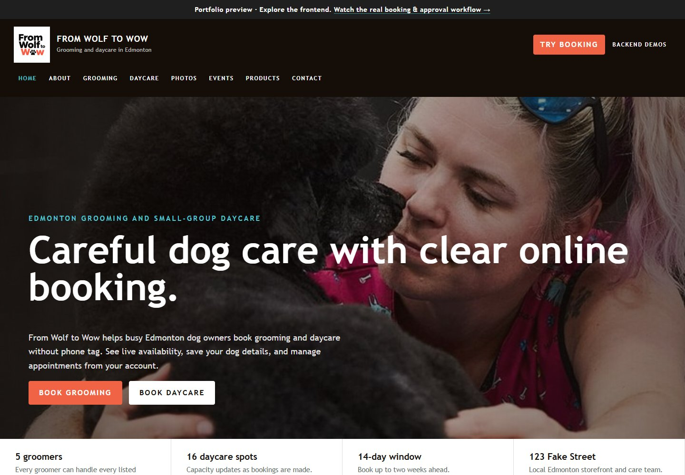
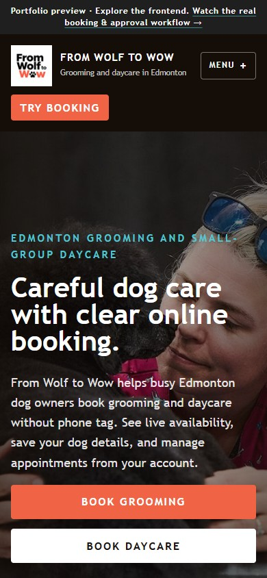
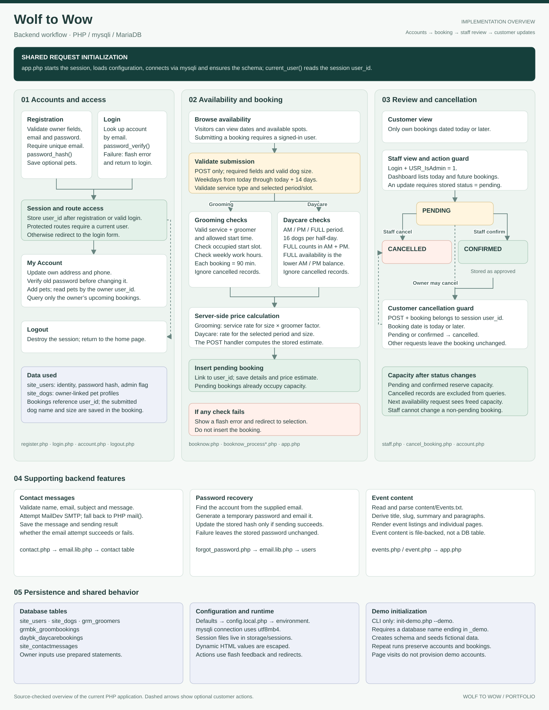

# Wolf to Wow

A responsive dog grooming and daycare website with customer accounts, service
estimates, capacity-aware booking and a staff approval dashboard.



## Explore the project

The frontend in `docs/` runs on GitHub Pages without PHP or a database. It includes
the original page designs, mobile navigation, an interactive booking estimate,
recorded backend demonstrations and the backend workflow diagram.

| Recording | What it shows |
| --- | --- |
| [Customer booking · 36 seconds](docs/media/customer-booking.mp4?raw=true) | Desktop grooming selection, service pricing and a saved request |
| [Staff approval · 11 seconds](docs/media/staff-approval.mp4?raw=true) | Reviewing a pending request and saving an administrator action |

Both recordings show the real local PHP/MySQL application using fictional data.
The published frontend plays them on `demo.html`. Its forms and availability are
demonstrations; they do not authenticate users or write bookings.

<details>
<summary>Mobile frontend preview</summary>



</details>

## Backend workflow

<details>
<summary>View the full backend logic diagram</summary>



[Open full-size diagram](docs/diagrams/backend-flow.svg)

</details>

Explore the implementation: [booking rules](app.php), [grooming submission](booknow_processgrooming.php),
[daycare submission](booknow_processdaycare.php), [staff review](staff.php),
[cancellation](cancel_booking.php) and [customer accounts](account.php).

## Run the PHP application locally

Tested with XAMPP: PHP 8.2 and MariaDB 10.4.

1. Place the project in `C:\xampp\htdocs\wolf-to-wow` and start Apache and MySQL.
2. Copy `config.local.example.php` to `config.local.php` if needed. Set database
   credentials and keep the database name `wolf_to_wow_demo`.
3. From the project folder, run:

   ```powershell
   C:\xampp\php\php.exe scripts/init-demo.php --demo
   ```

4. Open [the local PHP application](http://localhost/wolf-to-wow/).

Demo logins: `customer@example.com` and `staff@example.com`; initial password for
both: `PortfolioDemo123!`. Email requires a working mail service.

## Publish the frontend

After pushing to GitHub, choose **Settings → Pages → Deploy from a branch →
main → /docs → Save**. The frontend uses relative URLs and is ready to serve from
a repository's Pages address.

To regenerate it after PHP page changes, start the local app, install
`beautifulsoup4`, and run `python scripts/build-pages.py`. Compressed video files
are already included in `docs/media/`.

Based on supplied Skills Canada Alberta 2026 web-design starter materials.
Portfolio preparation used AI assistance.
